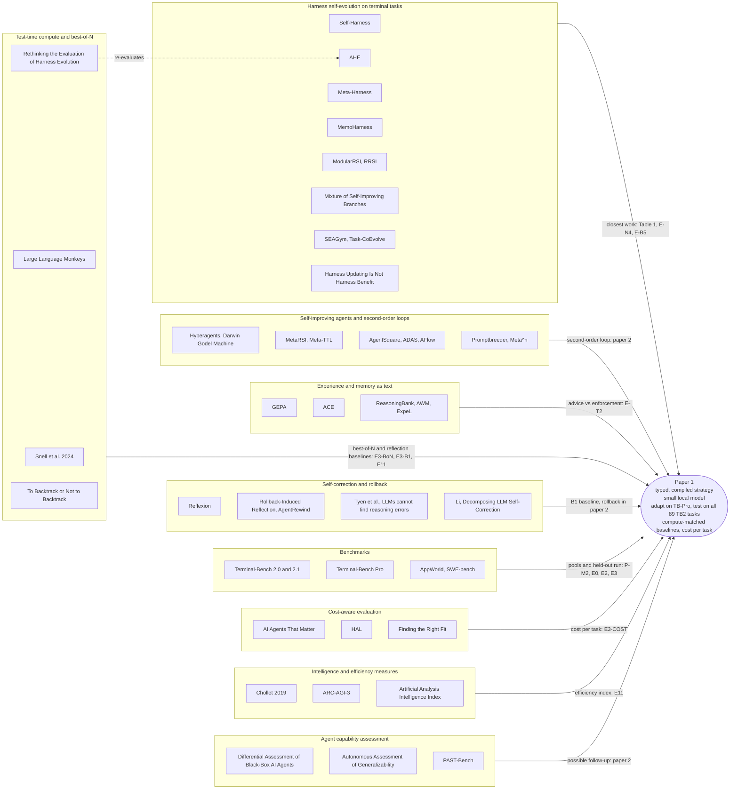

# Literature map for paper 1

Sagandeep Kaur, 2026-10-20. This map supports paper 1 of Project 2 ([TECHNICAL_PLAN.md](TECHNICAL_PLAN.md)). The longer per-paper notes and the benchmark survey are in [PRIOR_WORK.md](PRIOR_WORK.md).

**How it was checked.** Every paper below was opened at its source, usually the arXiv page, on or before 2026-10-20. Numbers come from the abstract or the HTML full text, as stated for each paper. "Full text read: yes" means the whole HTML version was read. "No" means the abstract plus the named sections, or a keyword search of the full text. A keyword search can miss things. So "no best-of-N baseline" means "not found", not "proven absent". Anything we could not confirm is marked "(unverified)" or "?".

**Acronyms.**

| Short form | Meaning |
|---|---|
| LLM | Large language model |
| TB2 | Terminal-Bench 2.0, 89 terminal tasks |
| TB2.1 | The revision of TB2 that fixes 28 of the 89 tasks |
| TB-Pro | Terminal-Bench Pro, 200 public tasks |
| BoN | Best-of-N: N independent attempts, one of which is selected |
| RSI | Recursive self-improvement |
| RL | Reinforcement learning |
| ID / OOD | In-distribution / out-of-distribution |
| pp | Percentage points |
| CI | Confidence interval |
| MDE | Minimum detectable effect |
| API | Application programming interface; an "API model" is used through a provider's service |
| GPU | Graphics processing unit |
| RQ1 to RQ4 | The research questions in [TECHNICAL_PLAN.md](TECHNICAL_PLAN.md), section 1 |
| MCU | Model Compute Units, the plan's cost unit: a fitted weighting of prompt and generated tokens from llama.cpp timings |
| S0 | The base strategy |
| S\*1, S\*2 | The strategies chosen by the adaptation loops with seeds 1 and 2 |
| S\* | The per-task average of S\*1 ×5 and S\*2 ×5 runs (10 runs per task). In the single-seed branch, S\*1 ×10 |
| VBS, SBS | Virtual best solver (best version per task), single best solver (best version overall) |
| CER_test | Compute-equivalence ratio: how many S0 best-of-N samples the adapted strategy is worth per task |

---

## 1. Clusters

The diagram groups the literature into nine clusters. Each arrow says what the cluster gives paper 1, with the experiment cards it touches (legend in section 2).

| Cluster | What it gives paper 1 | Key papers in section 3 |
|---|---|---|
| Harness self-evolution on terminal tasks | The closest prior work. Same benchmark, often the same loop shape | 3.1 to 3.12 |
| Self-improving agents and second-order loops | The second-order question (RQ3), now planned for paper 2 | 3.13 to 3.15 |
| Experience and memory as text | Prose adaptation, the "advised" side of E-T2 | 3.16, 3.17 |
| Test-time compute and best-of-N | The baselines that adaptation has to beat at equal cost | 3.2, 3.18, 3.19 |
| Self-correction and rollback | The reflection baseline B1, and rollback for paper 2 | 3.20, 3.21 |
| Benchmarks | Adaptation and test pools | 3.22 |
| Cost-aware evaluation | Reporting cost per task (meeting item 1) | 3.23 |
| Intelligence and efficiency measures | The efficiency index (meeting item 4, reading to be confirmed) | 3.24 |
| Agent capability assessment | Background for a possible follow-up on capability assessment of strategy versions (paper 2) | 3.25 |

---

## 2. Experiment cards referred to below

Card ids follow [EXPERIMENTS.md](EXPERIMENTS.md), the paper-1 experiment plan of 2026-10-20, which has the full designs. Nothing has been run yet.

| Card | What it is |
|---|---|
| P-M2 | CPU-only pilot: build TB-Pro, remove near-duplicates of TB2 tasks, check each task with Harbor's Oracle agent. No model runs |
| E0 | S0 run 3 times on every surviving TB-Pro task. It sizes the pools of contested tasks |
| E2 | Three adaptation loops on TB-Pro (two seeds of the adapted strategy S\*, plus the random-edit control B4), 6 rounds each |
| E3 | The pre-registered final run on all 89 TB2 tasks: S0, S\*, B4 and B1. This split is pending the supervisor's approval; the fallback is a TB2 re-split grouped by sibling tasks |
| E3-BoN | Best-of-N built from the S0 runs, selected by a judge, matched to S\* per task in MCU |
| E3-B1 | Reflection-retry inside one episode (Reflexion-style), matched to S\* per task |
| E3-COST | The cost-per-task table for every arm (meeting item 1) |
| E3-AUDIT | Network logs and a text search of every TB2 trial for benchmark leakage |
| E3-REF | A descriptive comparison of S0 with a public TB2 reference run |
| E0-JUDGE | Checks whether the judge can tell passing from failing TB-Pro trajectories |
| G1 | The `compile()` gate: each strategy field either changes the controller (with a unit test) or is labelled text-only |
| E-T2 | Enforced versus advised: the same strategy content as compiled controller settings or as prompt text |
| E-ATTR | Leave-one-out attribution by strategy dimension, plus an arm with lessons and notes switched off |
| E-N4 | Expressiveness audit: map the published edits of Self-Harness, AHE and MemoHarness onto our schema. No model runs |
| E-B5 | Optional baseline: free-form edits of the controller code (Tier C, run only if compute allows) |
| E4-SW | Offline strategy switching: choose one version per task from a library. No extra episodes |
| E11 | The efficiency index, computed after the fact from logs (CER_test, with the payback point T\*) |
| E-T12 | Shift in the failure taxonomy across rounds, and diagnoser agreement, on TB-Pro logs |
| E-N1 | Net pass@k of S\* minus S0 |
| E-T1lite | Optional check of the adapted strategy on a second small model (Tier C) |
| LINT-PILOT | A lint that rejects task ids, URLs, long commands and task paths in notes and lessons |
| LEDGER | Append-only log of every access to held-out tasks |
| Paper 2 | E5 second-order loop, E8 AppWorld transfer, E9 rollback versus restart, E10 model ladder |

---

## 3. Key papers

Each entry gives what the paper does, its verified key result, what it leaves open for us, which cards it threatens or supports, and whether we read the full text.

### Harness self-evolution on terminal tasks

**3.1 [Self-Harness: Harnesses That Improve Themselves](https://arxiv.org/abs/2606.09498) (Zhang et al., arXiv 2606.09498, Jun 2026).**
*Does.* A fixed model improves its own harness in a three-stage loop: Weakness Mining, Harness Proposal (minimal edits tied to failures) and Proposal Validation (an edit is accepted only after regression testing). No stronger external agent is used. The harness is a Python file that configures a DeepAgent, and the edits are code diffs. Models are MiniMax M2.5, Qwen3.5-35B-A3B and GLM-5; benchmarks are TB2, SWE-bench Verified and AppWorld.
*Key result.* For Qwen3.5-35B-A3B on a fixed 64-task TB2 subset, the overall pass rate rises from 18.0% to 36.7%, and held-out from 23.8% to 38.1%. The held-out rates fit 10/42 and 16/42, that is 21 tasks with 2 attempts each. These denominators are our inference; the paper does not print them. The model was served on four NVIDIA H200 GPUs.
*Leaves open.* It compares only the initial harness with the final one. It has no best-of-N, reflection or cost-matched baseline, no token or cost figures and no confidence intervals. The four retained Qwen edits (dependency prechecking, loop breaking, command-retry discipline, artifact-focused recovery) are merged with no per-edit contribution. Each model is evolved separately; we found no harness moved across models.
*Cards.* Threatens any "first" claim, so paper 1 makes none. Supports E-N4, which maps those four edits onto our schema. Motivates E-B5 and E3-BoN. Its code is public on GitHub with no licence file (checked 2026-10-20). A comparison on its 64-task subset is reported only if the task list can be recovered.
*Full text read:* yes (HTML v3).

**3.2 [Rethinking the Evaluation of Harness Evolution for Agents](https://arxiv.org/abs/2607.12227) (Wang et al., arXiv 2607.12227, Jul 2026).**
*Does.* Compares automatic harness evolution (AHE, with its retrieval agent disabled) against parallel sampling and sequential refinement under matched rollout budgets on TB2.1. Parallel sampling picks the final trajectory by a self-judge, or by unit tests when those are allowed. It also splits TB2.1 into 45 training, 10 validation and 34 held-out test tasks. Models are Claude Opus 4.6, GPT-5.4 and GPT-5.4 mini, with two runs each.
*Key result.* Without unit tests, parallel sampling raises the average pass@1 from 68.2 to 72.3. Harness evolution does not beat direct sampling on average and drops GPT-5.4 from 75.3 to 69.7. On the held-out split the evolved harness changes pass@1 by +1.2, 0 and -1.4 points across the three models, which is flat on average. Harness evolution does help on long-horizon games (ARC-AGI-3 and EdgeBench).
*Leaves open.* Only frontier API models are used. The harness is free-form. There is no typed strategy, no small local model and no per-component attribution on TB2.1. Its sampling and refinement comparisons are on the searched tasks; its held-out split has no sampling baseline; budgets are matched by rollout count; harness-modification cost is excluded; results are means of two runs, with no CIs.
*Cards.* The closest precedent for the design of E3-BoN and E3-B1, and it supports the held-out design of P-M2 and E3. It also threatens the novelty of a "compute-matched test" framing, so paper 1 must cite it and state how it differs. Its self-judge selection is the analogue of our judge-selected best-of-N, so E0-JUDGE matters.
*Full text read:* no (abstract, method and TB2.1 result sections of HTML v4).

**3.3 [Agentic Harness Engineering: Observability-Driven Automatic Evolution of Coding-Agent Harnesses](https://arxiv.org/abs/2604.25850) (Lin et al., arXiv 2604.25850, Apr 2026).**
*Does.* AHE evolves a harness whose components are files. It distils trajectories into a layered evidence corpus. Each edit carries a self-declared prediction that is checked against the next round's task outcomes.
*Key result.* Ten iterations lift TB2 pass@1 from 69.7% to 77.0% with GPT-5.4, above Codex-CLI at 71.9%. The frozen harness gives +5.1 to +10.1 pp on TB2 across three other model families. Ablations place the gain in tools, middleware and long-term memory; the system prompt alone regresses. The abstract suggests that "factual harness structure transfers while prose-level strategy does not".
*Leaves open.* Evolution and evaluation use the same 89 TB2 tasks; held-out evidence comes from SWE-bench Verified and other models. It uses a frontier model and has no best-of-N baseline (not found). Attribution is per component file, not per typed strategy dimension. It reports tokens per trial but no cost-matched comparison.
*Cards.* Threatens the novelty of E-ATTR, since component ablations already exist. Supports the hypothesis behind E-T2 (enforced structure beats prose). Its edits are mapped in E-N4. Its edit predictions correspond to the predictions we log with each edit.
*Full text read:* no (abstract; setup, transfer and ablation sections of the HTML).

**3.4 [Meta-Harness: End-to-End Optimization of Model Harnesses](https://arxiv.org/abs/2603.28052) (Lee et al., arXiv 2603.28052, Mar 2026).**
*Does.* An outer loop searches over harness code. The proposer (Claude Code with Opus 4.6) reads the code, scores and traces of all earlier candidates through a filesystem. The base model is frozen.
*Key result.* On online text classification it gains 7.7 points over ACE with 4x fewer context tokens. On maths, one harness gains 4.7 points on average across five held-out models. On TB2 it reaches 76.4% with Opus 4.6 and 37.6% with Haiku 4.5, above the hand-engineered harnesses it compares against.
*Leaves open.* Its "Best-of-N" is a compute-matched control for search, used only on text classification, not on TB2. On TB2, search and final evaluation use the same 89 tasks. It uses frontier models and searches free-form code.
*Cards.* The common baseline of this cluster. Supports the held-out design of E3. Motivates E-B5 (code space) and E3-BoN (the missing test-time comparison on TB2).
*Full text read:* no (abstract, sections 4.1 and 4.3).

**3.5 [MemoHarness: Agent Harnesses That Learn from Experience](https://arxiv.org/abs/2607.14159) (Huang et al., arXiv 2607.14159, Jul 2026).**
*Does.* Splits the harness into six control dimensions: context assembly, tool interaction, generation control, orchestration, memory management and output processing. They are stored as a structured policy file paired with text instructions. The harness is adapted to each case at test time from retrieved experience, without test labels, feedback or extra search.
*Key result.* On an 89-task Terminal-Bench suite with an 80/20 split (18 held-out tasks), it reports 0.806 against 0.722 for the strongest product-harness baseline, as point estimates. Search uses GPT-5.3-Codex. The harness also transfers to six other models.
*Leaves open.* No best-of-N, reflection or cost-matched baseline. No per-dimension ablation, and no confidence intervals. The abstract leaves statistical robustness and component attribution to future work. It does not say which parts of each dimension are code and which are prompt text.
*Cards.* Partly threatens the "structured strategy" claim. E-N4 maps its edits. E4-SW cites it as per-case adaptation. G1 and E-ATTR address the two gaps it names: what is compiled, and which dimension carries the gain.
*Full text read:* no (abstract and parts of the HTML).

**3.6 [ModularRSI: Modular and Generalizable Recursive Harness Self-Improvement](https://arxiv.org/abs/2609.14857) (Wu et al., arXiv 2609.14857, Sep 2026).**
*Does.* Five harness modules (Agent Loop, Tool Use, Observation Management, Context Management, Task Completion Detection) evolve separately and are then merged. Evidence comes from contrasting successful and failed trajectories. Evolution uses 2,000 curated tasks that are disjoint from the test benchmarks.
*Key result.* With DeepSeek-V4-Flash-Preview, in-domain evolution raises TB2 accuracy from 47.57% to 52.43%. Under one benchmark-disjoint protocol with matched evolution budgets it beats Meta-Harness (49.44%) and AHE (49.81%). The harness transfers across foundation models with gains of about 2% to 5%.
*Leaves open.* No best-of-N baseline (not found). Its ablations remove parts of the method, not individual modules. Its main model is DeepSeek-V4-Flash-Preview, whose size and serving we did not check.
*Cards.* Threatens the "dimension-wise structure" claim, because its modules are close to our dimensions. Supports P-M2 and E2, which adapt on a pool disjoint from the test benchmark. E-ATTR measures what it does not: the contribution of each changed dimension group.
*Full text read:* no (abstract, introduction, ablation section).

**3.7 [RRSI: Regularized Recursive Self-Improvement of Agent Harnesses](https://arxiv.org/abs/2609.24972) (Xia et al., arXiv 2609.24972, Sep 2026).**
*Does.* Regularises harness evolution. The proposer has an annealed limit on how many edits a candidate may bundle. A critic screens out benchmark-specific proposals, and a pruner removes changes that are too small, too costly or no longer useful. The policy model is frozen.
*Key result.* Across eight benchmarks, including TB2.1 and SWE-bench Verified, it gains up to 6.0 points on the split it evolves against and up to 4.3 points on five OOD benchmarks. Its harness uses 30% fewer policy tokens than unregularised evolution. Four earlier methods are run under the same candidate budget.
*Leaves open.* Frontier models only (Claude Opus 4.8 and Gemini 3.5 Flash in the coding domain). No best-of-N baseline (not found). Ablations cover the regulariser groups, not harness components.
*Cards.* Supports the E2 selection rule: at most 2 edit operations per candidate, acceptance by integer net task counts, and a separate confirmation set. Supports LINT-PILOT, which rejects task-specific text. Paper 1 does not claim novel overfitting controls.
*Full text read:* no (abstract, setup and results sections).

**3.8 [MetaRSI / RSI2: A Meta-Recursive Self-Improving System for Recursive Self-Improving Systems Themselves](https://arxiv.org/abs/2609.06396) (Tan et al., arXiv 2609.06396, Sep 2026).**
*Does.* Three typed operators share one loop kernel. Data-RSI synthesises training records, Harness-RSI edits a five-slot scaffold under a typed patch without touching weights, and Model-RSI trains low-rank (LoRA) adapters. A meta-level policy revises the order of operators across terms. The target model plays every role, with no external teacher.
*Key result.* On a self-hosted Qwen3.5-35B-A3B, evaluated on sealed held-out splits of TB2.1 and SWE-bench Pro, scheduled composition beats the best single operator and a hand-fixed pipeline. All conditions receive identical totals of tokens, GPU-hours, wall-clock time and candidates, and results are means over five seeds. Six frontier models also improve on TB2.1 through the Data-RSI and Harness-RSI route, with no weight changes.
*Leaves open.* In the main setting the weights change (Model-RSI), but the Harness-RSI-only condition keeps them frozen and reaches 29.4 from 23.6 on TB2.1. Baselines are other improvement schedules; we found no test-time best-of-N or reflection baseline. Attribution is per operator, not per slot.
*Cards.* Threatens the typed-strategy claim (typed patches exist), the frozen-weights angle and the "same model class on TB2" angle. Its equal-budget, multi-seed protocol supports our pre-registered design. Its second-order element is relevant to E5 (paper 2).
*Full text read:* no (abstract, sections 5.1 to 5.3).

**3.9 [Mixture of Self-Improving Branches For Agent Harness Optimization](https://arxiv.org/abs/2609.37834) (Dong et al., arXiv 2609.37834, Sep 2026).**
*Does.* Keeps several branches, each with its own evolving development subset and proposal guidance. A router sends each new input to one branch head. Selection uses development data only.
*Key result.* Relative to Meta-Harness it improves by 34.8% on Olympiad-level maths, 11.6% on TB2 and 3.8% on SWE-bench Lite. On TB2 it splits the tasks into 30 development and 58 held-out tasks, with Claude Sonnet 4.5 as the action model.
*Leaves open.* The authors note that total token use differs between methods. No best-of-N baseline (not found). Frontier models only.
*Cards.* Threatens the novelty of per-task strategy switching (meeting item 5, reading still to be confirmed). E4-SW cites it and differs by measuring the VBS minus SBS headroom with cross-fitting, reporting selector regret, and comparing library plus selector with S\* at matched per-task MCU. Its adaptive proposal guidance is a form of second-order loop, which is paper-2 material (E5).
*Full text read:* no (abstract and setup).

**3.10 [SEAGym: An Evaluation Environment for Self-Evolving LLM Agents](https://arxiv.org/abs/2606.17546) (Zheng et al., arXiv 2606.17546, Jun 2026).**
*Does.* Turns Harbor-compatible benchmarks into sources for self-evolution. It provides training batches, frozen update-validation, held-out ID and OOD views, replay checks, saved snapshots and cost records.
*Key result.* With DeepSeek-V4-Flash on TB2 and the HLE benchmark it compares ACE, Training-Free GRPO and AHE. It finds that frequent updates may fail to improve held-out performance and that useful intermediate snapshots may collapse later. Moving a harness evolved with DeepSeek to other models gives mixed results: +7.3 points ID for GLM but -3.6 for GPT-5.4.
*Leaves open.* It is a protocol, not a method. No best-of-N baseline (not found).
*Cards.* Supports LEDGER and the held-out separation in E3. Supports the E2 choice of S\* on a separate confirmation set rather than taking the last snapshot. Supports E3-COST.
*Full text read:* no (abstract and setup).

**3.11 [Task-CoEvolve: Efficient Harness Optimization via Adaptive Validation Task Selection](https://arxiv.org/abs/2608.20169) (Miyai et al., arXiv 2608.20169, Aug 2026).**
*Does.* Chooses validation tasks by variance-weighted sampling of past outcomes, so evaluation focuses on tasks where candidates disagree. It estimates the full-set score from the sampled subset.
*Key result.* It matches full-set search with 80% fewer evaluations. On TB2.1 it uses GPT-5.6 Luna and Qwen3.6-35B-A3B. With Qwen3.6-35B-A3B the starting harnesses score 34.8% (Terminus 2) and 32.6% (Terminus-KIRA), and full Meta-Harness search reaches 42.7%.
*Leaves open.* Search and final evaluation use the same 89 tasks, so there is no held-out result.
*Cards.* Supports E2, whose validation pool holds only contested tasks. It uses our primary model on TB2.1, which gives context for E3-REF. Those numbers come from another benchmark version and harness and are not directly comparable.
*Full text read:* no (abstract, sections 4.3 and 4.4).

**3.12 [Harness Updating Is Not Harness Benefit: Disentangling Evolution Capabilities in Self-Evolving LLM Agents](https://arxiv.org/abs/2605.30621) (Lin et al., arXiv 2605.30621, May 2026).**
*Does.* Separates two abilities: writing useful harness updates, and benefiting from an updated harness.
*Key result.* Updating ability is flat in base capability: updates written by Qwen3.5-9B give gains comparable to those written by Claude Opus 4.6. Benefit is non-monotonic: weak models gain little because they fail to activate or follow harness artifacts. On SkillsBench the harness-following rate is 0.142 for Qwen3-32B and 0.757 for Opus 4.6.
*Leaves open.* It uses SWE-bench Verified, MCP-Atlas and SkillsBench, not Terminal-Bench. It does not test enforcing harness content in code.
*Cards.* The main motivation for E-T2 and for the adherence tags in G1. A caution for E-T1lite and the paper-2 model ladder (E10).
*Full text read:* no (abstract, section 4.1, Table 2).

### Self-improving agents and second-order loops

**3.13 [Hyperagents](https://arxiv.org/abs/2603.19461) (Zhang et al., arXiv 2603.19461, Mar 2026).**
*Does.* Extends the Darwin Gödel Machine so that "the meta-level modification procedure is itself editable". The task agent and the meta agent are one editable Python program around a frozen model.
*Key result.* It measures meta-level improvement with an imp@k metric that holds the meta agent fixed. Meta-level improvements such as persistent memory and performance tracking "transfer across domains and accumulate across runs". Domains are coding (Polyglot), paper review, robotics reward design and maths grading. Each method runs 5 times, with medians and bootstrap CIs.
*Leaves open.* Edits are free-form code. No best-of-N baseline (not found). No terminal tasks.
*Cards.* The main threat to RQ3. RQ3 and the second-order loop move to paper 2 by default (E5), pending confirmation with Prof. Abdelrazek. The imp@k metric is a candidate measure for paper 2.
*Full text read:* no (abstract, method and evaluation sections).

**3.14 [Meta-TTL: Meta-Learning Self-Improvement Policies for Language Agents](https://arxiv.org/abs/2604.00830) (Lou et al., arXiv 2604.00830, Apr 2026).**
*Does.* A bi-level setup. The inner loop is test-time learning across episodes. The outer loop meta-trains the self-improvement policy across tasks. The actor is a frozen Gemini-3-Flash, and only its system prompt changes.
*Key result.* Up to +23% on ID tasks and +27% on OOD tasks over the strongest baseline, on Jericho, WebArena-Lite and τ²-bench (latest version, v4).
*Leaves open.* No terminal tasks. The policy edits prompt text only.
*Cards.* A threat to RQ3 framing; relevant to E5 (paper 2). Not a paper-1 baseline.
*Full text read:* no (abstract and setup).

**3.15 [AgentSquare: Automatic LLM Agent Search in Modular Design Space](https://arxiv.org/abs/2410.06153) (Shang et al., arXiv 2410.06153, Oct 2024).**
*Does.* Searches a fixed modular design space of Planning, Reasoning, Tool Use and Memory modules by module evolution and recombination, with a performance predictor to save evaluations.
*Key result.* +17.2% over the best human designs on six benchmarks, including web shopping (WebShop) and embodied tasks (ALFWorld, ScienceWorld), with GPT-3.5-turbo and GPT-4o.
*Leaves open.* The search procedure is fixed. No terminal tasks and no best-of-N baseline (not found).
*Cards.* Threatens the "searchable structured strategy" claim. G1 and E-T2 are what differ: fields that are compiled and tested, and a test of enforcement against advice.
*Full text read:* no (abstract, setup, ablation).

### Experience and memory as text

**3.16 [GEPA: Reflective Prompt Evolution Can Outperform Reinforcement Learning](https://arxiv.org/abs/2507.19457) (Agrawal et al., arXiv 2507.19457, Jul 2025).**
*Does.* Reflects on trajectories in natural language, proposes prompt updates and keeps a Pareto set of candidates.
*Key result.* With Qwen3 8B it beats the reinforcement-learning method GRPO trained on 24,000 rollouts by up to 20% while using up to 35x fewer rollouts. Prompts optimised with Qwen3 8B also help GPT-4.1 Mini.
*Leaves open.* It optimises prompt text with a fixed optimiser. No agents on terminal tasks.
*Cards.* The prose baseline B3 leaves paper 1, so GEPA is cited but not run. E-T2's advised cell is our test of the same content as prose.
*Full text read:* no (abstract, setup).

**3.17 [Agentic Context Engineering: Evolving Contexts for Self-Improving Language Models](https://arxiv.org/abs/2510.04618) (Zhang et al., arXiv 2510.04618, Oct 2025).**
*Does.* Maintains an evolving playbook with a generator, a reflector and a curator, using incremental updates.
*Key result.* +10.6% on agent benchmarks including AppWorld, with DeepSeek-V3.1. Section 4.6 reports that it still works with a much weaker reflector and degrades gracefully under noisy reflections.
*Leaves open.* The playbook is free text. No terminal tasks. When AHE moved ACE's TB2 playbook to SWE-bench Verified, ACE fell below its seed.
*Cards.* Like GEPA, cited but not run in paper 1. Its robustness result bears on diagnosis-noise injection, which is paper-2 work.
*Full text read:* no (abstract, sections 4.1 and 4.6).

### Test-time compute and best-of-N

**3.18 [Scaling LLM Test-Time Compute Optimally can be More Effective than Scaling Model Parameters](https://arxiv.org/abs/2408.03314) (Snell et al., arXiv 2408.03314, Aug 2024).**
*Does.* Studies how a fixed test-time budget should be spent per prompt, on verifier search or on sequential revision.
*Key result.* A compute-optimal strategy is more than 4x more efficient than a best-of-N baseline. In a comparison matched on floating-point operations (FLOPs), a smaller model with test-time compute can beat a 14x larger model where its base success rate is not trivial.
*Leaves open.* Single prompts, not agents. No adaptation across tasks.
*Cards.* Supports E3-BoN and E11. CER_test asks the same question per task: how much best-of-N compute equals the adapted strategy.
*Full text read:* no (abstract only).

**3.19 [Large Language Monkeys: Scaling Inference Compute with Repeated Sampling](https://arxiv.org/abs/2407.21787) (Brown et al., arXiv 2407.21787, Jul 2024).**
*Does.* Measures how coverage (problems solved by any sample) grows with the number of samples.
*Key result.* Coverage scales over four orders of magnitude of samples. On SWE-bench Lite, DeepSeek-Coder-V2-Instruct goes from 15.9% with one sample to 56% with 250. Without automatic verifiers, majority voting and reward models plateau beyond several hundred samples.
*Leaves open.* No agent adaptation. Selection without a verifier is the weak point.
*Cards.* Supports E0-JUDGE: a realistic selector, not the oracle, decides the best-of-N baseline. Oracle pass@N is plotted only as a ceiling. Relevant to E-N1.
*Full text read:* no (abstract only).

### Self-correction and rollback

**3.20 [Reflexion: Language Agents with Verbal Reinforcement Learning](https://arxiv.org/abs/2303.11366) (Shinn et al., arXiv 2303.11366, Mar 2023).**
*Does.* Agents "verbally reflect on task feedback" and keep the reflections in an episodic memory buffer, without weight updates.
*Key result.* Not re-checked for this map. We use Reflexion for its method, not for its numbers.
*Leaves open.* Learning stays within one task; nothing carries over as a strategy.
*Cards.* The basis of baseline B1 (E3-B1).
*Full text read:* no (abstract only).

**3.21 [Rollback the World, Keep the Reflection: Rollback-Induced Reflection for Long-Horizon LLM Agents](https://arxiv.org/abs/2609.18304) (Yu et al., arXiv 2609.18304, Sep 2026).**
*Does.* Treats recovery as choosing when to intervene, where to resume and what to keep. It restores a selected earlier state and carries forward knowledge distilled from the abandoned branch.
*Key result.* Higher average task performance on ALFWorld, ScienceWorld and GAIA, with Qwen3-14B, DeepSeek-V3 and Qwen3.8-27B as backbones. A related system, [AgentRewind](https://arxiv.org/abs/2608.14380) (Zhuang et al., arXiv 2608.14380, Aug 2026), checkpoints context and environment together and reports results on its own MettleBench and on TB2 tasks.
*Leaves open.* No terminal tasks for this paper. No per-strategy adaptation of rollback settings.
*Cards.* Rollback versus restart is paper-2 work (E9). Rollback values are removed from the paper-1 edit space (G1).
*Full text read:* no (abstract and experimental setup).

### Benchmarks

**3.22 [Terminal-Bench: Benchmarking Agents on Hard, Realistic Tasks in Command Line Interfaces](https://arxiv.org/abs/2601.11868) (Merrill et al., arXiv 2601.11868, Jan 2026).**
*Does.* Defines TB2: 89 tasks, each a Docker environment with an instruction, tests that check the final container state, and a reference solution, run through the Harbor harness.
*Key result.* Each model and agent pair was run at least five times. Most trials finish in under 20 minutes. The cheapest models sit near the floor, for example gpt-oss-20b at 3.1% with Terminus 2. Contamination protection relies on a canary string only. TB2.1 later fixed 28 of the 89 tasks. Terminal Bench Pro was introduced in [Let It Flow](https://arxiv.org/abs/2512.24873) (Wang et al., arXiv 2512.24873, Dec 2025); its public Hugging Face dataset has 200 tasks under Apache-2.0.
*Leaves open.* No private test set, so held-out use needs care.
*Cards.* Defines E3 and supports running each arm several times per task. The canary-only protection motivates E3-AUDIT and LEDGER. Its failure classes seed the taxonomy in E-T12. TB-Pro supplies the adaptation pools (P-M2, E0, E2).
*Full text read:* no (main text, Table 2 and the error-analysis appendix).

### Cost-aware evaluation

**3.23 [Holistic Agent Leaderboard: The Missing Infrastructure for AI Agent Evaluation](https://arxiv.org/abs/2510.11977) (Kapoor et al., arXiv 2510.11977, Oct 2025).**
*Does.* A standardised harness that runs agent evaluations in parallel across many virtual machines, analysed across models, scaffolds and benchmarks.
*Key result.* 21,730 agent rollouts over 9 models and 9 benchmarks, for about $40,000. Higher reasoning effort reduced accuracy in most runs. Log inspection found agents searching for the benchmark on Hugging Face instead of solving the task.
*Leaves open.* No adaptation across tasks. No terminal benchmark in the abstract.
*Cards.* Supports E3-COST. The benchmark-search behaviour supports the text search in E3-AUDIT. The earlier paper by the same group, [AI Agents That Matter](https://arxiv.org/abs/2407.01502) (Kapoor et al., arXiv 2407.01502, Jul 2024), argues for optimising cost and accuracy together and for proper holdout sets.
*Full text read:* no (abstract only).

### Intelligence and efficiency measures

**3.24 [On the Measure of Intelligence](https://arxiv.org/abs/1911.01547) (Chollet, arXiv 1911.01547, Nov 2019).**
*Does.* Defines intelligence as skill-acquisition efficiency. The formal definition also weighs scope, generalisation difficulty, priors and experience.
*Key result.* A conceptual framework, not an empirical result.
*Leaves open.* No operational measure for LLM agents that adapt their strategy.
*Cards.* E11. Reading (a) of meeting item 4 follows Chollet and is still to be confirmed with Prof. Abdelrazek. By default the headline is CER_test with T\* as a companion; the index is an operationalisation, not Chollet's formal measure. ARC-AGI-3's efficiency scoring against human action baselines ([arXiv 2603.24621](https://arxiv.org/abs/2603.24621)) is not used. Reading (b), a composite like the Artificial Analysis Intelligence Index, appears only in the model-choice table.
*Full text read:* no (abstract only).

### Agent capability assessment

**3.25 [Differential Assessment of Black-Box AI Agents](https://arxiv.org/abs/2203.13236) (Nayyar et al., arXiv 2203.13236, Mar 2022).**
*Does.* Updates a known model of an agent after its behaviour has drifted, using an active querying policy.
*Key result.* The abstract claims an assessment cost proportional to the amount of drift. AAAI 2022.
*Leaves open.* Not applied to LLM agents adapting a strategy.
*Cards.* None in paper 1. Background for a possible follow-up on capability assessment of strategy versions (paper 2).
*Full text read:* no (abstract only).

---

## 4. Comparison matrix (draft of paper Table 1)

This is the draft of Table 1 in paper 1. A cell says "yes" or "no" only where a check supports it. "No" for an absent feature, such as a baseline or a second-order loop, means "not found in a keyword search of the full text". "?" means not checked or unclear. Notes below the table give the evidence.

Column definitions:

- **Typed strategy.** The adapted object is typed or structured (fields, slots or modules), not free code or free text.
- **Frozen weights.** Model weights do not change during adaptation.
- **Terminal bench.** Evaluated on TB2, TB2.1 or a later Terminal-Bench.
- **Small local model.** An open-weight model of at most about 35B total parameters, served by the authors.
- **Cost-matched BoN.** A test-time best-of-N (or equivalent sampling) baseline at matched cost.
- **Held-out eval.** Final results on tasks not used for search or selection.
- **Per-component attribution.** Ablation by component or dimension of the adapted object.
- **Second-order loop.** The improvement mechanism itself is adapted.
- **Cross-model.** The adapted object is moved to other models and evaluated.

| Work | Typed strategy | Frozen weights | Terminal bench | Small local model | Cost-matched BoN | Held-out eval | Per-component attribution | Second-order loop | Cross-model |
|---|---|---|---|---|---|---|---|---|---|
| Self-Harness (2606.09498) | no | yes | yes | yes | no | yes | no | no | no |
| AHE (2604.25850) | partly | yes | yes | no | no | partly | yes | no | yes |
| MemoHarness (2607.14159) | partly | yes | yes | no | no | yes | no | no | yes |
| ModularRSI (2609.14857) | partly | ? | yes | ? | no | yes | partly | ? | yes |
| SEAGym (2606.17546) | n/a | yes | yes | ? | no | yes | n/a | no | yes |
| Meta-Harness (2603.28052) | no | yes | yes | no | partly | partly | ? | no | partly |
| Mixture of Self-Improving Branches (2609.37834) | no | yes | yes | no | no | yes | partly | partly | ? |
| RRSI (2609.24972) | no | yes | yes | no | no | yes | partly | no | yes |
| MetaRSI (2609.06396) | yes | partly | yes | yes | no | yes | partly | yes | no |
| AgentSquare (2410.06153) | partly | yes | no | no | no | ? | partly | no | ? |
| GEPA (2507.19457) | no | yes | no | partly | no | yes | partly | no | yes |
| ACE (2510.04618) | no | yes | no | no | no | yes | partly | no | partly |
| Hyperagents (2603.19461) | no | yes | no | no | no | yes | ? | yes | ? |
| Rethinking Harness Evolution (2607.12227) | n/a | yes | yes | no | yes | yes | n/a | no | partly |
| Task-CoEvolve (2608.20169) | no | yes | yes | partly | no | no | ? | no | ? |
| Harness Updating Is Not Harness Benefit (2605.30621) | no | yes | no | partly | ? | ? | partly | no | yes |
| **This project, paper 1 (planned)** | yes | yes | yes | yes | yes | yes | yes | no | no |

No single column is unique to paper 1. The combination we did not find is a test-time best-of-N and reflection comparison on held-out tasks for a typed, compiled strategy of a small local model.

**Notes on the cells.**

1. **Self-Harness.** Harness is a Python file; edits are code diffs. Qwen3.5-35B-A3B is one of three models. It meets the column definition, although it was served on four H200 GPUs. Only initial versus final harness is compared. Held-out tasks are never shown to the proposer. The four retained edits are merged without per-edit results. Each model is evolved separately.
2. **AHE.** Components are files (tools, middleware, memory, prompt), hence "partly" typed. Evolution and evaluation share the 89 TB2 tasks; held-out evidence is SWE-bench Verified only. Component ablations on TB2. Transfer to three other model families.
3. **MemoHarness.** Six-dimension structured policy file plus text instructions; the code and text split is not stated. 18 held-out tasks. Search with GPT-5.3-Codex; transfer to six models.
4. **ModularRSI.** Five modules evolved separately. Weight status not found in a text search. Main model DeepSeek-V4-Flash-Preview; its size and serving were not checked. Evaluation benchmarks are disjoint from its 2,000 evolution tasks. Ablations remove method parts, not modules. Whether its loop adapts its own mechanism was not checked.
5. **SEAGym.** An evaluation environment, so typed strategy and attribution do not apply. The three methods it runs (ACE, Training-Free GRPO, AHE) do not train weights. Main model DeepSeek-V4-Flash, size and serving not checked. Cross-model results are mixed.
6. **Meta-Harness.** Best-of-N appears only as a search control on text classification, not on TB2. Held-out sets exist for text classification and maths; on TB2 search and evaluation share all 89 tasks. Maths harness tested on five held-out models.
7. **Mixture of Self-Improving Branches.** Updates revise proposal guidance, not weights. TB2 split 30 development and 58 held-out. Ablations cover development-set and proposal updates. Branch-local proposal guidance adapts during search, hence "partly" second-order.
8. **RRSI.** Frozen policy. Same candidate budget for all harness-evolution methods, but no best-of-N. Five OOD benchmarks. Ablations by regulariser group. A harness evolved with one model is run on a weaker one on TB2.1.
9. **MetaRSI.** Typed operators and a typed patch on a five-slot scaffold. Model-RSI trains LoRA adapters, hence "partly" frozen. Self-hosted Qwen3.5-35B-A3B. Equal budgets across improvement schedules, but no test-time best-of-N. The Harness-RSI-only condition keeps the weights frozen and goes from 23.6 to 29.4 on TB2.1. Sealed held-out splits. Attribution per operator. The meta-level policy revises the schedule. Frontier models each run their own loop.
10. **AgentSquare.** A fixed design space of four module slots, but a module can be any code with a standard interface, hence "partly" typed. GPT-3.5-turbo and GPT-4o. Reports a performance-cost comparison but no best-of-N. Ablations of its search components.
11. **GEPA.** Prompt text. Qwen3 8B is used, but how it was served was not checked, hence "partly". Standard train, validation and test splits. Ablation of candidate selection. Prompts optimised on Qwen3 8B also help GPT-4.1 Mini.
12. **ACE.** Free-text playbook on DeepSeek-V3.1 (671B). AppWorld test-normal and test-challenge splits. Ablations of reflector, multi-epoch and delta updates. The method is re-run on other base models, which is not transfer of one playbook.
13. **Hyperagents.** One editable Python program around a frozen model. A held-out domain (maths grading) is reserved for meta-evaluation. The meta procedure is editable.
14. **Rethinking Harness Evolution.** An evaluation study of AHE. Parallel sampling and sequential refinement at matched rollout budgets on TB2.1. A 45/10/34 task split. The matched-budget comparison is on the searched tasks; the held-out split has no sampling baseline. Budgets are matched by rollout count (K = 5), and harness-modification cost is excluded. Each of three frontier models runs its own evolution.
15. **Task-CoEvolve.** Harness code. Qwen3.6-35B-A3B on TB2.1, serving not checked. Search and evaluation share all 89 tasks.
16. **Harness Updating Is Not Harness Benefit.** Prompts, skills and memories. Qwen3.5-9B and Qwen3-32B among the models. It measures activation and adherence of harness artifacts, hence "partly" attribution. Updates written by one model are used by others.
17. **This project.** All cells are planned, not results. Typed: only fields that pass the G1 compile test count as enforced. Cost-matched baselines: pooled best-of-N and reflection-retry matched per task in MCU (E3-BoN, E3-B1). Held-out: adapt on TB-Pro, test on all 89 TB2 tasks, pending the supervisor's approval of the new split. Attribution: leave-one-out by dimension group (E-ATTR), exploratory. The second-order loop and cross-model transfer move to paper 2 by default.

---

## 5. What the map means for the paper-1 claim

The paper-1 contribution, as fixed on 2026-10-20, is:

> A pre-registered, compute-matched test of whether adapting a typed, compiled strategy of a small, locally served model on Terminal-Bench beats a fixed strategy, random edits, reflection-retry and best-of-N, with cost per task reported for every arm and mechanism evidence (enforced-vs-advised contrast, leave-one-out attribution over changed strategy-dimension groups).

In E-ATTR the leave-one-out unit is a changed dimension group of S\*1, not a single field.

What the map supports:

- None of the harness-evolution methods in the matrix reports a test-time best-of-N comparison at matched cost on a terminal benchmark. The evaluation study 2607.12227 does. On TB2.1 with three frontier API models, it matches evolution, parallel sampling and sequential refinement by rollout count (K = 5) on the searched tasks, and evolution does not win. Paper 1 asks a related but different question: whether a strategy adapted once on TB-Pro beats best-of-N and reflection-retry on held-out TB2 tasks at matched per-task test-time compute, for a small local model. Unlike 2607.12227, our per-task matching excludes the one-time adaptation cost, which we report separately as the payback point T\*. Paper 1 must cite 2607.12227 as its closest precedent.
- MetaRSI already applies typed operators to a self-hosted Qwen3.5-35B-A3B on a sealed TB2.1 split, with equal token and GPU-hour budgets and five seeds. Only its Harness-RSI-only condition keeps the weights frozen; it edits a typed five-slot scaffold and goes from 23.6 to 29.4. Frozen weights, typed edits, a small self-hosted model and an equal-budget held-out evaluation are therefore not distinct from it. Paper 1 differs in its comparators and mechanism tests: test-time best-of-N and reflection-retry matched per task on held-out tasks, a random-edit control inside the same edit space (MetaRSI randomises operator order, not edits), a unit test per compiled field with text-only fields labelled, and the enforced-versus-advised contrast. Two of MetaRSI's five slots are prose (system prompt, memory), and we did not find a separation of enforced from advised content.
- AHE, ModularRSI and MemoHarness already structure the harness into components, and AHE already ablates components on TB2. Our leave-one-out attribution differs only in its unit (changed dimension groups of one typed strategy) and is exploratory with an MDE of about 12 pp; it is not a novelty claim. What we did not find is E-T2: the same strategy content delivered as compiled controller settings versus as prompt advice, holding content fixed. The closest evidence is AHE's finding that the system prompt alone regresses, and 2605.30621 on weak models failing to follow harness artifacts.

What paper 1 does not claim: a "first" self-improving harness on TB2 or for small models; the first compute-matched comparison of harness adaptation with test-time sampling or refinement on Terminal-Bench (2607.12227 ran one with frontier models); the first typed or frozen-weight harness adaptation of a small self-hosted model on Terminal-Bench (MetaRSI); the first adaptation on a task source disjoint from TB2 with TB2 used only for evaluation (ModularRSI); gains from a second-order loop; transfer across benchmark families or across models; that typed beats code; that diagnosis beats random search in general. The typed space is presented as a deliberate restriction of code space, chosen for compiled enforcement, attribution and auditability.

---

## 6. Other papers checked

These were opened and are cited where relevant. They did not make the list of 25.

| Paper | What it is | Relevance |
|---|---|---|
| [To Backtrack or Not to Backtrack](https://arxiv.org/abs/2504.07052) (Qin et al., arXiv 2504.07052, Apr 2025) | Sequential search loses to parallel sampling on CountDown and wins on Sudoku | Any backtracking or retry result needs an equal-compute best-of-N (E3-BoN) |
| [LLMs cannot find reasoning errors, but can correct them given the error location](https://arxiv.org/abs/2311.08516) (Tyen et al., arXiv 2311.08516, Nov 2023) | LLMs are poor at finding the wrong step but correct it once told where | Diagnosis is the bottleneck (E-T12) |
| [Decomposing LLM Self-Correction](https://arxiv.org/abs/2601.00828) (Li, arXiv 2601.00828, Dec 2025) | Splits detection, localisation and correction on GSM8K-Complex with three LLMs; model-generated location hints hurt | Caution for diagnosis quality (E-T12) |
| [Does Reinforcement Learning Really Incentivize Reasoning Capacity in LLMs Beyond the Base Model?](https://arxiv.org/abs/2504.13837) (Yue et al., arXiv 2504.13837, Apr 2025) | RL-trained models win at small k; base models win at large k | Report net pass@k across k (E-N1) |
| [HarnessBank](https://arxiv.org/abs/2607.13683) (Luo et al., arXiv 2607.13683, Jul 2026) | Gene bank of harnesses with gated screening; +5.1% to 15.4% on seven benchmarks; gains are model-specific | Caution for cross-model claims (E-T1lite) |
| [SelfSearch](https://arxiv.org/abs/2609.37968) (Yang et al., arXiv 2609.37968, Sep 2026) | Reward-free self-modification from records of past attempts; up to +11.2 pp on TB2.1; 82.0% on TB2.1 with DeepSeek V4 Flash for $4.03 of search | A search-cost reference point (E3-COST, E11) |
| [Finding the Right Fit](https://arxiv.org/abs/2610.00917) (Li et al., arXiv 2610.00917, Oct 2026) | 66 model and harness configurations; rankings reverse across harnesses; higher cost does not reliably buy a higher score | Supports reporting cost per task and pinning the harness (E3-COST) |
| [It's Not the Capability](https://arxiv.org/abs/2605.26731) (Cho, arXiv 2605.26731, May 2026) | Harness sensitivity is non-monotone across model tiers on a 24-task synthetic benchmark; does not test code enforcement | Does not pre-empt E-T2 |
| [AI4AI at Test-Time](https://arxiv.org/abs/2608.12307) (Qian et al., arXiv 2608.12307, Aug 2026) | A strong builder writes harnesses for weaker targets on Theory-of-Mind benchmarks; weaker targets gain most | Supports moving behaviour into code (E-T2) |
| [Self-Evolving Coding Agents via Harness-Policy Optimization](https://arxiv.org/abs/2610.22791) (Wei et al., arXiv 2610.22791, Oct 2026) | Alternates harness search and RL on Qwen3.5-35B-A3B | Contrast only: weights change |
| [Tmax](https://arxiv.org/abs/2606.23321) (Ivison et al., arXiv 2606.23321, Jun 2026) | An RL recipe reaching 27% on TB2 with 9B parameters; data, models and code released | A candidate fallback model and the E-T1lite model |
| [Agentic Abstention](https://arxiv.org/abs/2606.28733) (Luo et al., arXiv 2606.28733, Jun 2026) | When an agent should stop acting; includes terminal environments | Background for a give-up field (paper 2) |
| [Autonomous Assessment of Generalizability of AI Agent Capabilities](https://arxiv.org/abs/2512.16733) (Bramblett et al., arXiv 2512.16733, Dec 2025) | Learns symbolic stochastic capability models by tree-search query synthesis | Background for a possible follow-up on capability assessment of strategy versions (paper 2) |
| [PAST-Bench](https://arxiv.org/abs/2608.04003) (Xue et al., arXiv 2608.04003, Aug 2026) | Turns retained experience on and off; checks whether gains follow the intended save, retrieve and update pathway | Supports mechanism evidence: the lessons-and-notes-off arm in E-ATTR |
| [ARC-AGI-3](https://arxiv.org/abs/2603.24621) (ARC Prize Foundation, arXiv 2603.24621, Mar 2026) | Interactive benchmark with efficiency-based scoring against human action baselines | Considered for E11 and not used |
| Artificial Analysis Intelligence Index, methodology page v4.3.2 | Weighted average of ten evaluations; includes Terminal-Bench 4.0 at 10% weight | Reading (b) of meeting item 4; model-choice table only |
| [Meta^n](https://arxiv.org/abs/2608.24735) (Kim et al., arXiv 2608.24735, Aug 2026) | Recursive meta-layers; above zero on ARC-AGI-2; the abstract does not mention Terminal-Bench | Paper 2 (E5) |
| [Mendel Gödel Machine](https://arxiv.org/abs/2608.07645) (Liu et al., arXiv 2608.07645, Aug 2026) | Edits an agent from its trajectories on several tasks at once; SWE-bench and Polyglot | Close to our aggregate-then-propose step in E2 |
| [Self Improvement via Fast Tree-search](https://arxiv.org/abs/2609.19526) (Fu et al., arXiv 2609.19526, Sep 2026) | A pairwise LLM judge ranks candidate self-modifications before full evaluation; Polyglot | An alternative cheap screen for E2; not adopted |
| [Recursive Self-Improvement in AI](https://arxiv.org/abs/2607.07663) (Chen et al., arXiv 2607.07663, Jul 2026) | Survey of 1,250 papers; separates bounded self-refinement from open-ended RSI | Our loop is bounded self-refinement in its terms |
| [Terminal Agents: A Survey](https://arxiv.org/abs/2608.20485) (Bin et al., arXiv 2608.20485, Aug 2026) | Behaviour depends on model, interface, harness, runtime and environment together | Supports pinning runtime settings in the pre-registration |
