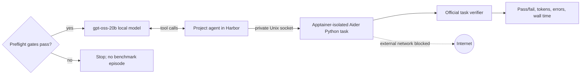

# Project update for Prof. Mohamed Abdelrazek

**Meeting:** Monday, 16 November 2026  
**Prepared by:** Sagandeep Kaur  
**Project:** Adaptive-Agent-Strategies, branch `docs/research-plan-2026-10`

## Purpose of the meeting

The project has working infrastructure and several completed engineering checks, but it does not yet have benchmark findings. The main goal of this meeting is to agree on decisions that unblock the research route without presenting setup tests as evidence of agent performance.

## Executive summary

- Qwen3.6-35B-A3B can run locally on an A2I2 L40S through llama.cpp. Two Harbor runs completed a small synthetic file-writing task with reward 1.0 and no harness errors. Both runs allowed task internet, so they are setup evidence only. No Terminal-Bench Pro (TB-Pro) benchmark episode has run.
- A scripted, **no-model** Rohan test passed the tested Apptainer network-isolation configuration and a patched Harbor Unix-socket control channel. The checked internet and metadata connections failed while Harbor health checks and command execution still worked. This proves that one synthetic configuration worked; it does not prove every task will work with these settings or say anything about Qwen's behavior.
- The no-episode serving sweep found all 12 tested slot/cache/context combinations fit on an L40S with at least 16.8 GiB sampled VRAM headroom. In one matched long-prompt cell, an RTX Pro 6000 delivered about 1.35 times the L40S aggregate throughput. These synthetic request measurements are not task throughput, cost per task, or an E-P0 result.
- The baseline acceptance audit is complete and G-BASE is green. A desk audit of published strategy edits found only 1 of 23 operation-level rows currently code-enforced. The planned `compile()` work is paused because the required `restart_task` behavior has no honest reset implementation in the current Harbor lifecycle.
- TB-Pro remains blocked on the accepted image route and licence evidence. An external issue reporter's GHCR results make a possible fallback more plausible, but are not our results, maintainer approval, or proof of equivalent environments.

**Current research result:** zero TB-Pro benchmark episodes, zero project Oracle/reference-solution runs on TB-Pro, and no solve-rate or cost-per-task claim.

## Proposed alternate pilot at a glance

This is an additive exploratory route for the separate follow-on PR. It does not replace the current proposal or its primary benchmark.

The gpt-oss serving-only tool-call smoke passed on Rohan's RTX Pro 6000. A no-model Python 3.11 synthetic preflight also passed through the Apptainer/Harbor provider: offline pytest ran, Harbor control worked over a private Unix socket, and external IP, DNS, and metadata checks were blocked. It used a generic Python SIF and called provider internals directly, so the Aider adapter's image and normal Harbor trial lifecycle remain unverified. Rootless Docker still cannot start a container because the node lacks a cgroup controller path. If the exact image and trial gates pass, the proposed pilot is six Python tasks with one frozen starting strategy and one attempt per task. It is descriptive evidence only, not a confirmatory score. The existing `restart_task` option stays in the proposal; this pilot does not establish that its controller action is implemented. See the [gpt-oss run record](experiments/gpt-oss-serving-smoke-2026-11-17.md) and [Python preflight record](experiments/aider-python-image-preflight-2026-11-17.md).

**Local checks completed:** cached `llama3:latest` (8.0B, Q4_0) returned the correct answer to one synthetic word-reversal prompt in 8.62 seconds (28 prompt tokens, 40 generated), but its installed Ollama package rejected tool calls. On Rohan, gpt-oss-20b returned a native `reverse_words` call on the RTX Pro 6000; that function was not executed. A Python 3.11.18 Apptainer smoke ran one synthetic pytest test with offline wheels while UDS control worked and network probes failed as intended. The rootless-Docker task-container probe failed at container startup because the node lacks a cgroup controller path. These are engineering checks, not Aider tasks or benchmark results. No Aider task has run.

Full model/benchmark selection, run gates, and the exact local smoke record are in the [alternate pilot note](experiments/ALT-MODEL-BENCHMARK-PILOT-2026-11-16.md).

## Work completed and evidence

### 1. Model serving and synthetic Harbor runs

The pinned Qwen3.6-35B-A3B model, Q4_K_M quantization, was served on Rohan's L40S with llama.cpp. The project's OpenAI-compatible client and Harbor adapter made native tool calls, completed the synthetic task, and read reward from Harbor's saved trial result.

| Run | Evidence | Limit |
|---|---|---|
| Harbor job 4410693 | One synthetic file-write trial; reward 1.0; zero errors or retries | Task explicitly allowed internet; bounded strategy fixture; not TB-Pro |
| Harbor job 4433963 | Repeat after token-budget changes; one synthetic trial; reward 1.0; zero errors or retries | Same synthetic task; internet isolation not tested |

The logs from these runs were later searched for the specified network and privilege-related indicators. No suspicious-command indicators appeared in the recorded agent step logs. The search was limited to the saved logs and is not proof of network isolation or of the model's intent.

### 2. Serving sweep: engineering measurement, not an episode experiment

The synthetic load sweep varied 1, 2, or 4 slots; f16 or q8_0 KV cache; and per-slot context sizes of 65,536 or 98,304 tokens. All 12 fit-screen configurations fit on the L40S, with a minimum sampled headroom of 16,817 MiB.

For a matched 64,896-token prompt and 512-token output cap at four slots with q8_0 cache:

| GPU | Aggregate prompt plus generated throughput | Median call time |
|---|---:|---:|
| L40S | 4,504 tokens/s | 57.4 s |
| RTX Pro 6000 | 6,062 tokens/s | 42.8 s |

The RTX Pro result is about 1.35 times the L40S result for this one synthetic cell, based on three batch repetitions. The model sometimes stopped before the output cap. An A100 was not tested. The measurements do not establish task-level speed, timeouts, episodes per GPU-day, MCU coefficients, or cost per task. E-P0 is still required.

There is one operational follow-up: six serving jobs have runner records showing success while Slurm reports `FAILED 1:0`. A login-shell logout hook is the likely cause and a wrapper fix is recorded. A one-minute CPU job on Rohan is still needed to verify `sacct` reports `COMPLETED 0:0`.

### 3. Baselines and strategy expressiveness

The baseline work repaired and tested:

- vendor-matched sampling values and distinct logged request seeds;
- a blind judge that receives the task and public attempt, not hidden tests;
- B1 retry and reflection behavior;
- exact Best-of-N selection and cost accounting; and
- the shared 64,000 generated-token budget for B1 agent, judge, and reflection calls.

The six G-BASE acceptance outcomes are documented and **G-BASE is green**. This does not close the five-task TB-Pro infrastructure gate.

The most recent offline-suite CI passed on Python 3.11 and 3.12 at commit `ac1268b` ([push workflow](https://github.com/Sagankaur/Adaptive-Agent-Strategies/actions/runs/42766647181), [PR workflow](https://github.com/Sagankaur/Adaptive-Agent-Strategies/actions/runs/42766650404)). The current meeting-report files are documentation-only additions after that commit.

The E-N4 desk audit mapped published operations from Self-Harness, AHE, and MemoHarness to the current strategy schema and runtime. Of 23 operation-level rows, 1 is code-enforced, 9 are prompt-text-only, and 13 are not expressible. This is a current-implementation comparison, not an evaluation of the papers' performance.

### 4. Harbor control channel and network isolation

Jobs 4626138, 4626144, and 4698238 tested Apptainer 1.3.3 on Rohan. The latest integrated smoke, **job 4698238**, was a scripted no-model test on a CPU node and completed in 20 seconds with exit `0:0`.

It used `--net --network none --writable-tmpfs --containall`, without `--fakeroot`, and a patched Harbor provider communicating over a private Unix socket. The smoke passed Harbor health checks, command execution, a job-specific nonce round trip, a write to `/app`, shutdown, and socket cleanup. The tested external IP, DNS lookup, and metadata endpoint requests failed; only loopback was visible inside the task network.

A2I2 support said this Apptainer network configuration should be permitted, but they had not tested it themselves. They do not provide a cluster-wide job egress block. Therefore:

- the test establishes that this exact synthetic setup worked technically;
- it does not establish compatibility with every TB-Pro task or arbitrary task permissions;
- it does not establish that Qwen3.6 attempted or did not attempt network access; and
- it does not itself authorize a real-model or benchmark job.

The project also added a command tripwire for URLs, IP addresses, `unshare`, `nsenter`, and `mount`. It logs matching commands for review; it is monitoring, not a network security control. Harbor telemetry is explicitly disabled in future scripts with `HARBOR_TELEMETRY=off`; telemetry status for the two older runs is unknown.

### 5. TB-Pro route and external GHCR report

The TB-Pro authors' email requesting supported images and written licence confirmation was sent on 30 October; the repository's last recorded status on that email is no reply as of 6 November. The Aliyun registry timed out from Rohan and other networks. Our CPU job 4413248 successfully pulled the two public Laude Terminal-Bench base images from GHCR, but this only shows that the images are reachable; it does not show they match TB-Pro's custom images.

The user commented on public issue #10 asking for image/digest information and maintainer guidance. The issue reporter replied on 10 November with a report of:

- 192/200 passed in a full sweep using the two GHCR bases;
- 199/200 cumulatively passed after targeted reruns and several environment repairs; and
- one chess task still exceeded match-test timeouts in both environments.

The reporter says the 199/200 figure is cumulative, not a second full sweep. Their reported repairs included dependency pins, local dataset recovery, resource/thread adjustments, verifier configuration, and a verifier log-pipe change. Their recovered custom Python image came from a cache and had no `RepoDigests`; the GHCR Python image had six layers in common with the first six of that recovered nine-layer image. The reporter is another benchmark user, not a maintainer, and explicitly asks maintainers whether the GHCR images are supported.

This is external feasibility evidence only. It does not satisfy the project's licence requirement, verify equivalence, establish our per-task route or the minimum 120-task survivor threshold, or replace explicit approval for changing P-M2. **No TB-Pro task image has been built and no TB-Pro Oracle/reference solution has been run by this project.**

### 6. Storage and reproducibility

The cluster documentation says scratch is temporary and RDS is the long-term research store. The RDS Activity/Collection and transfer are not yet set up; Rohan's RDS SSH host-key verification remains unresolved. Some synthetic sweep artifacts are copied into the repository, while raw Harbor logs remain on cluster scratch. We should finish the RDS setup before accumulating large experiment outputs.

## Open design and safety issues

### Model decision (Q9)

Cohere's advisory concerns Qwen3.8-Flash-Next and describes a blocked outbound attempt with uncertain intent. This project pins Qwen3.6-35B-A3B, a different version; the report does not establish that our pinned model made the same attempt. A2I2 recommends caution and another model where possible. No alternative model has yet been qualified for this study.

The existing decision record asks whether to keep Qwen3.6 as a candidate under verified task-container isolation, pause it and qualify another model, or defer the decision. Until this is decided, real-model task-command jobs remain paused. Even a decision to keep Qwen would not clear the TB-Pro licence/image gates.

### `compile()` and `restart_task` (G1)

The planned contribution is a compiler that turns strategy fields into enforced controller behavior and separates enforcement from prompt advice. The current feasibility note says Harbor provides no task reset or snapshot/restore operation. Resetting only chat history leaves task files and processes intact; launching a new Harbor trial changes the episode budget and accounting. Calling either one a task restart would be misleading.

Implementation stopped before code changes. G1 is **not green**: there is no compiler, per-field test registry, generated Table 2, or G1 test ID set. The plan requires narrowing the paper's typed-strategy claim if a recovery field cannot be implemented honestly.

### Protocol disclosure

On 5 November, an AI assistant read public `instruction.md` files for 13 TB2 sibling-candidate pairs (26 pair-task appearances across 19 distinct task IDs) for split-leakage review. No tests, solutions, environments, Oracle outputs, or experimental outcomes were read. No further TB2 task-text reads will occur. This familiarity risk applies to both proposed benchmark routes and must be disclosed in the pre-registration limitations. The task IDs are recorded in the internal decision log; they are omitted here because they are not needed for this meeting decision.

## Decisions requested in this meeting

1. **Model:** Should the project retain pinned Qwen3.6 as a candidate under the tested isolation controls, qualify another model, or defer the decision? No choice will be inferred from the support reply.
2. **TB-Pro route:** If the authors/maintainers have not responded by 20 November, should I seek explicit approval for the proposed GHCR fallback and its revised licence/equivalence rules? The external user's 199/200 cumulative result is supporting context, not approval. Any changed route still needs the registered per-task checks and at least 120 eligible tasks.
3. **G1 recovery implementation:** Keep `restart_task` in the strategy space. Implement and test a real same-trial task reset that preserves the episode budget; until then, do not claim the field is compiled or mark G1 green.
4. **Five-task smoke:** What must the smoke demonstrate to count as passing G-INFRA, including model choice, network isolation, acceptable task permissions, and zero harness errors?
5. **Prior research framing, if time:** Confirm the working interpretation of the adaptation-efficiency/intelligence-index question and whether strategy switching is per-task selection from a library or within-task switching. These decisions affect the protocol and effort estimates.

## Proposed next sequence

1. Record the model, route, and recovery-scope decisions, with any protocol changes explicit before running tasks.
2. Resolve the licence/image route and finish the P-M2 per-task route, overlap, disk, and survivor-count checks. Do not run TB2 agents or Oracle.
3. Complete only the approved five-task TB-Pro smoke and verify the infrastructure gate.
4. Run E-P0 to measure actual episode throughput, timeout rates, and MCU coefficients; use those measurements to select the serving configuration.
5. Proceed to the registered baseline and adaptation experiments only after the relevant gates are documented.
6. Configure RDS and copy important raw results off volatile scratch.

## Suggested opening for the meeting

> “The cluster and harness are working for small synthetic tests, and we have a scripted network-isolation test that keeps Harbor's control channel working. Those are engineering results; we still have no TB-Pro benchmark result. I need your guidance on the model choice, what route changes we can approve if the benchmark authors stay silent, and whether we narrow the recovery edit space because Harbor cannot honestly restart a task today.”

## Supporting records

- [Qwen Harbor smoke](experiments/Qwen-Harbor-real-model-smoke-2026-10.md)
- [Serving sweep](experiments/serving-sweep-2026-11.md)
- [Harbor egress safety review](experiments/harbor-egress-safety-2026-11.md)
- [G-BASE audit](experiments/G-BASE-audit-2026-10-30.md)
- [E-N4 expressiveness audit](experiments/E-N4-expressiveness-audit-2026-11.md)
- [G1 feasibility note](experiments/G1-compile-2026-11.md)
- [P-M2 preflight and GHCR follow-up](experiments/P-M2-preflight-2026-10-30.md)
- [DECISIONS.md](DECISIONS.md)

