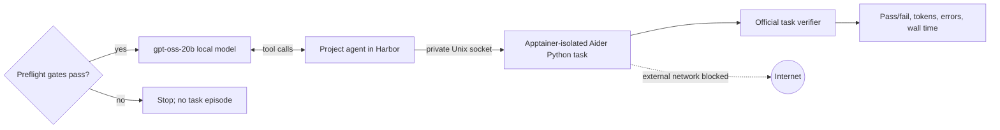

# Exploratory non-Qwen benchmark pilot: gpt-oss-20b on Aider Polyglot

**Status:** the gpt-oss serving-only tool-call smoke passed; Aider benchmark episodes have not run. This document is an additive, exploratory track for a separate follow-on PR. It does not replace the current proposal, change its primary benchmark/model, or close any existing gate.

## Decision for the exploratory track

- **Model candidate:** OpenAI gpt-oss-20b, served locally. It is a non-Qwen, open-weight model with an Apache-2.0 license and documented function-calling support. The model page lists 21B total parameters, 3.6B active parameters, and a 131,072-token context. A serving-only tool-call smoke passed on Rohan; the exact model and SIF hashes are recorded in [the run report](gpt-oss-serving-smoke-2026-11-17.md). This does not qualify it on benchmark tasks.
- **Benchmark candidate:** the Aider Polyglot benchmark through Harbor's adapter at the project's existing Harbor v0.23.0 pin (`1e5c5c6db929a10a140d05e606882c671ae20729`). The adapter documents 225 code-editing tasks in six languages and MIT licensing for the benchmark and its Exercism source material. Start with the Python subset only; do not claim a full Polyglot score from that sample.
- **Pilot size:** six Python tasks, one frozen starting strategy and one attempt per task. Freeze task IDs by a documented seed before reading their instructions. Report each task's official verifier outcome, aggregate pass fraction, model/tool errors, tokens, and wall time. Treat this as descriptive feasibility evidence, not a confirmatory result or a comparison with the main proposal.
- **Scoring rule:** use only the benchmark's official verifier; do not run or inspect its bundled oracle/reference solution. Keep task data and generated run artifacts outside the public repository.

This choice separates the pilot from both Terminal-Bench Pro and Terminal-Bench 2. No TB2 task, instruction, test, solution, or outcome is part of this pilot.

### Run flow

The task data and verifier stay inside the isolated environment; the agent uses Harbor's private Unix socket to issue commands. The preflight gate must pass before any model-driven task run.

## Why this model and benchmark

The local non-Qwen model already available on the workstation (Llama 3 8B, Q4_0) does not expose tool calling through the installed Ollama registry entry, so it is not a suitable agent candidate without changing the model package or adding a nonstandard tool parser. gpt-oss-20b is a stronger next candidate because its published interface includes function calling and its weight license permits local experimentation. It also provides a meaningful response to A2I2's advice to exercise caution with the recent Qwen family.

Aider Polyglot is a coding benchmark with editable repositories and unit-test-based verification, so it exercises the project's coding-agent question on a benchmark distinct from the Terminal-Bench tasks. Its Harbor adapter is pinned with the existing Harbor version. The adapter's documented setup uses Docker. The task-image route is not yet established on Rohan, where A2I2 also provides Apptainer and rootless Docker.

## Workstation Llama 3 smoke

On 2026-11-16, the local Ollama endpoint at `127.0.0.1:11434` was tested with the cached `llama3:latest` model:

| Property | Observed value |
|---|---|
| Local model manifest digest | `365c0bd3c000a25d28ddbf732fe1c6add414de7275464c4e4d1c3b5fcb5d8ad1` |
| Model format / size / quantization | GGUF / 8.0B / Q4_0; 4,661,224,676 bytes |
| GPU available to workstation | GeForce RTX 5060, 8,151 MiB reported; inference device was not separately logged |
| Prompt | “Reverse the words in this sentence, keeping punctuation attached to its word: red blue green.” |
| Output | “green blue red.” (correct for this synthetic check) |
| Request wall time | 8.62 seconds; this includes the request and may include model load time |
| Ollama prompt / generated tokens | 28 / 40 |
| Tool-call check | **Failed compatibility gate:** Ollama returned `model ... does not support tools` for `llama3:latest` |

This is one synthetic text-generation smoke, not a benchmark task, agent episode, Harbor run, or evidence of model quality. It is recorded to rule out the cached Llama 3 package as the immediate tool-using alternative. The tool-call result is specific to the local Ollama model package and does not establish that every Llama 3 serving stack lacks tool support.

## Rohan gpt-oss serving smoke

The pinned gpt-oss-20b MXFP4 file and llama.cpp SIF loaded on Rohan's RTX Pro 6000. Job 4800647 returned one `reverse_words` function call with the exact requested argument. The server was bound to localhost, the function was not executed, and no task or Harbor trial ran. The warm request took 0.308 seconds with 149 prompt and 41 completion tokens; the post-load VRAM sample was 11,895 MiB. See the [complete run record](gpt-oss-serving-smoke-2026-11-17.md) and its small JSON/GPU artifacts.

## Execution blockers and gates

The Aider benchmark pilot has not run. The workstation has no Docker or Apptainer executable and only an 8 GiB GPU. Key-only SSH reached Rohan, transferred the scripts, and completed the serving-only job without using a password.

### Cluster checks and serving-only run files

During the successful login, Rohan exposed the Apptainer 1.3.3 module, the already-staged llama.cpp CUDA 12 SIF, and an RTX Pro 6000 node. Initially the model cache contained only the existing Qwen file. Job 4800639 then downloaded the pinned gpt-oss artifact at Hugging Face revision `41e8a94d15d62070b36cf4553a0250717ecf46b8`; the MXFP4 GGUF is 12,109,566,624 bytes and its SHA-256 check passed against `27cd6c432c7672cb812a92f611cf3ba7bbc35928262bb1e1253ff4ee6ae35901`.

The [fetch script](../cluster/serving-sweep/01_gpt_oss_fetch.sbatch) downloaded and verified the model in job 4800639. The [localhost-only synthetic tool-call script](../cluster/serving-sweep/02_gpt_oss_tool_call_smoke.sbatch) passed in job 4800647. The function was not executed, and no task was run.

Rohan also provides a `rootless-docker/rootless-docker` module, which looked like a route for Harbor's Docker-based Aider adapter. The no-model probe reached the rootless daemon and pulled a small Python image, but Docker could not start a container because the compute node lacked `/sys/fs/cgroup/user.slice/.../cgroup.controllers`. It did not test `network=none` or Harbor control. Do not run Aider tasks through this route unless A2I2 resolves the cgroup issue or identifies a supported setup. The probe is [recorded in the run report](gpt-oss-serving-smoke-2026-11-17.md).

### Python 3.11 Apptainer preflight

No-model job 4801425 passed a synthetic Python 3.11.18 + offline-pytest check through the patched Harbor provider's private Unix socket. Follow-up job 4801512 completed one synthetic task through Harbor's normal CLI lifecycle. It blocked the recorded IPv4, IPv6, DNS, and metadata probes, preserved UDS control, and verified `/wheels` and `/runtime-deps` were read-only. An independent review found the initial CLI run 4801507 had writable dependency mounts; the provider patch and fixture were corrected before 4801512. These remain setup checks using a generic `python:3.11-slim` SIF, not the Aider adapter's generated image. They do not resolve task dependency/image fidelity or hard resource-limit questions. See the [provider run record](aider-python-image-preflight-2026-11-17.md) and [normal-CLI follow-up](harbor-cli-egress-preflight-2026-11-17.md).

Before the six-task pilot:

1. Keep the gpt-oss model, SIF, sampling settings, and localhost tool-call smoke pinned as recorded.
2. Reproduce the pinned Aider Python runtime in an Apptainer task image, including the required command-line tools and offline test dependencies. The generic Python 3.11 SIF has now passed a normal Harbor CLI synthetic trial, but the adapter-generated task image and its dependency fidelity remain unverified; the rootless Docker route still fails at container startup.
3. Reproduce the exact adapter runtime in an Apptainer task image, then repeat the scripted no-model Harbor trial. The generic-image trial verifies the private control path, `network=none`, external/DNS/metadata failure, read-only staged dependencies, checked mount/environment patterns, and cleanup. It also shows Harbor's best-effort artifact check cannot run as root in this unprivileged provider. Check whether Aider tasks require root-dependent setup or complete root artifact collection, and resolve or explicitly bound task-level resource enforcement before model episodes; the provider currently advertises no hard per-task CPU or memory limits.
4. Freeze six Python task IDs and data/license handling before reading their instructions. Keep task data and generated run artifacts outside the public repository.
5. Run six one-attempt episodes only after the image and isolation checks pass. Report raw per-task verifier outcomes and the exact denominator. Do not tune on these tasks or infer a general benchmark score.

If the image route or isolation check fails, the pilot remains blocked. Do not switch to TB2 or TB-Pro as a workaround. The primary proposal and its existing gates remain unchanged.

## Restart-task behavior

This pilot does not remove or redefine `recovery.on_repeated_failure = restart_task`. Keep the strategy option in the existing proposal. The current exploratory smoke did not exercise task restart, and this six-task pilot must not be reported as evidence that restart is implemented or works. The restart action still needs its own controller test that demonstrates a real, budget-preserving task reset.

## Sources

- [OpenAI gpt-oss-20b model page](https://developers.openai.com/api/docs/models/gpt-oss-20b)
- [OpenAI guide to running gpt-oss locally](https://developers.openai.com/cookbook/articles/gpt-oss/run-transformers)
- [Harbor v0.23.0 Aider Polyglot adapter README](https://github.com/harbor-framework/harbor/blob/1e5c5c6db929a10a140d05e606882c671ae20729/adapters/aider_polyglot/README.md)
- [Harbor v0.23.0 Singularity/Apptainer environment implementation](https://github.com/harbor-framework/harbor/tree/1e5c5c6db929a10a140d05e606882c671ae20729/src/harbor/environments/singularity)
