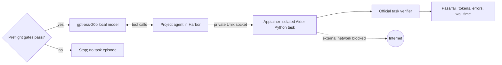

# Exploratory non-Qwen benchmark pilot: gpt-oss-20b on Aider Polyglot

**Status:** proposed pilot; benchmark episodes not run. This document is an additive, exploratory track for a separate follow-on PR. It does not replace the current proposal, change its primary benchmark/model, or close any existing gate.

## Decision for the exploratory track

- **Model candidate:** OpenAI gpt-oss-20b, served locally. It is a non-Qwen, open-weight model with an Apache-2.0 license and documented function-calling support. The model page lists 21B total parameters, 3.6B active parameters, and a 131,072-token context. The exact inference artifact, quantization, runtime build, and hashes still need pinning before a scored run.
- **Benchmark candidate:** the Aider Polyglot benchmark through Harbor's adapter at the project's existing Harbor v0.23.0 pin (`1e5c5c6db929a10a140d05e606882c671ae20729`). The adapter documents 225 code-editing tasks in six languages and MIT licensing for the benchmark and its Exercism source material. Start with the Python subset only; do not claim a full Polyglot score from that sample.
- **Pilot size:** six Python tasks, one frozen starting strategy and one attempt per task. Freeze task IDs by a documented seed before reading their instructions. Report each task's official verifier outcome, aggregate pass fraction, model/tool errors, tokens, and wall time. Treat this as descriptive feasibility evidence, not a confirmatory result or a comparison with the main proposal.
- **Scoring rule:** use only the benchmark's official verifier; do not run or inspect its bundled oracle/reference solution. Keep task data and generated run artifacts outside the public repository.

This choice separates the pilot from both Terminal-Bench Pro and Terminal-Bench 2. No TB2 task, instruction, test, solution, or outcome is part of this pilot.

### Run flow

The task data and verifier stay inside the isolated environment; the agent uses Harbor's private Unix socket to issue commands. The preflight gate must pass before any model-driven task run.

## Why this model and benchmark

The local non-Qwen model already available on the workstation (Llama 3 8B, Q4_0) does not expose tool calling through the installed Ollama registry entry, so it is not a suitable agent candidate without changing the model package or adding a nonstandard tool parser. gpt-oss-20b is a stronger next candidate because its published interface includes function calling and its weight license permits local experimentation. It also provides a meaningful response to A2I2's advice to exercise caution with the recent Qwen family.

Aider Polyglot is a coding benchmark with editable repositories and unit-test-based verification, so it exercises the project's coding-agent question on a benchmark distinct from the Terminal-Bench tasks. Its Harbor adapter is pinned with the existing Harbor version. The adapter's own setup instructions require Docker, however, so the task-image route is not yet established on the cluster's Apptainer-only setup.

## Workstation smoke already run

On 2026-11-16, the local Ollama endpoint at `127.0.0.1:11434` was tested with the cached `llama3:latest` model:

| Property | Observed value |
|---|---|
| Local model manifest digest | `365c0bd3c000a25d28ddbf732fe1c6add414de7275464c4e4d1c3b5fcb5d8ad1` |
| Model format / size / quantization | GGUF / 8.0B / Q4_0; 4,661,224,676 bytes |
| GPU available to workstation | GeForce RTX 5060, 8,151 MiB reported; inference device was not separately logged |
| Prompt | “Reverse the words in this sentence, keeping punctuation attached to its word: red blue green.” |
| Output | “green blue red.” (correct for this synthetic check) |
| Request wall time | 8.62 seconds; this includes the request and may include model load time |
| Ollama prompt / generated tokens | 28 / 40 |
| Tool-call check | **Failed compatibility gate:** Ollama returned `model ... does not support tools` for `llama3:latest` |

This is one synthetic text-generation smoke, not a benchmark task, agent episode, Harbor run, or evidence of model quality. It is recorded to rule out the cached Llama 3 package as the immediate tool-using alternative. The tool-call result is specific to the local Ollama model package and does not establish that every Llama 3 serving stack lacks tool support.

## Execution blockers and gates

The benchmark pilot and gpt-oss inference job have not run. The workstation has no Docker or Apptainer executable and only an 8 GiB GPU. A key-only SSH session did reach Rohan's `login-f` node once; later retries failed because the hostname stopped resolving, before I could upload or submit the GPU smoke. No password was requested or used.

### Cluster checks and serving-only run files

During the successful login, Rohan exposed the Apptainer 1.3.3 module, the already-staged llama.cpp CUDA 12 SIF, and an RTX Pro 6000 node. The model cache contained the existing Qwen file but no gpt-oss file. The Hugging Face model API supplied a pinned gpt-oss artifact revision (`41e8a94d15d62070b36cf4553a0250717ecf46b8`); its MXFP4 GGUF is 12,109,566,624 bytes with SHA-256 `27cd6c432c7672cb812a92f611cf3ba7bbc35928262bb1e1253ff4ee6ae35901`.

Two Slurm scripts are prepared for the next stable key-only session: [download and verify the model](../cluster/serving-sweep/01_gpt_oss_fetch.sbatch), then [run a localhost-only synthetic function-call smoke on the RTX Pro 6000](../cluster/serving-sweep/02_gpt_oss_tool_call_smoke.sbatch). The smoke does not execute the proposed function and does not run a task. Upload failed when DNS dropped, so no job was submitted and there is no gpt-oss result yet.

Before the six-task pilot:

1. Re-establish key-only Rohan access; record the serving node's GPU, runtime, disk, and model-cache availability.
2. Pin the gpt-oss-20b artifact and its digest, the llama.cpp/runtime build, sampling settings, and the exact OpenAI-compatible tool-call format. Run a no-task synthetic tool-call round trip first.
3. Resolve the Aider Python task image route without Docker: build or import a reproducible Apptainer image from the pinned task definitions and record its digest. Do not assume Harbor's Docker adapter automatically works under Apptainer.
4. Re-run the existing network-isolation checks with that exact image and adapter, including the model/control channel needed by Harbor, an external URL, and `169.254.169.254`. Keep the task-container command tripwire enabled. Isolation must preserve only the required local control/model path.
5. Confirm the six task IDs and data/license handling before any model episode. Keep task data and generated run artifacts outside the public repository.
6. Run six one-attempt episodes and report the raw per-task outcomes and aggregate with an exact denominator. Do not tune the strategy or model on these six tasks and do not infer a general benchmark score.

If the image route or isolation check fails, the pilot remains blocked. Do not switch to TB2 or TB-Pro as a workaround. The primary proposal and its existing gates remain unchanged.

## Restart-task behavior

This pilot does not remove or redefine `recovery.on_repeated_failure = restart_task`. Keep the strategy option in the existing proposal. The current exploratory smoke did not exercise task restart, and this six-task pilot must not be reported as evidence that restart is implemented or works. The restart action still needs its own controller test that demonstrates a real, budget-preserving task reset.

## Sources

- [OpenAI gpt-oss-20b model page](https://developers.openai.com/api/docs/models/gpt-oss-20b)
- [OpenAI guide to running gpt-oss locally](https://developers.openai.com/cookbook/articles/gpt-oss/run-transformers)
- [Harbor v0.23.0 Aider Polyglot adapter README](https://github.com/harbor-framework/harbor/blob/1e5c5c6db929a10a140d05e606882c671ae20729/adapters/aider_polyglot/README.md)
- [Harbor v0.23.0 Singularity/Apptainer environment implementation](https://github.com/harbor-framework/harbor/tree/1e5c5c6db929a10a140d05e606882c671ae20729/src/harbor/environments/singularity)
