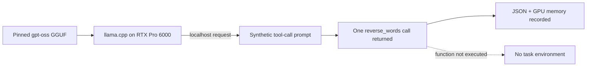

# gpt-oss-20b serving-only smoke on Rohan

**Status:** passed as a model-serving and tool-call compatibility check. No benchmark task, Harbor trial, or tool execution occurred.

## Result

Job **4800647** ran on the Rohan RTX Pro 6000 node. The pinned model loaded in llama.cpp and returned the requested native function call. The function was recorded, not executed.

| Measure | Result |
|---|---|
| Model artifact | `ggml-org/gpt-oss-20b-GGUF` at revision `41e8a94d15d62070b36cf4553a0250717ecf46b8` |
| File | `gpt-oss-20b-MXFP4.gguf`, 12,109,566,624 bytes |
| Model SHA-256 | `27cd6c432c7672cb812a92f611cf3ba7bbc35928262bb1e1253ff4ee6ae35901` |
| Server image | llama.cpp `server-cuda12-b11515`; local SIF SHA-256 `dd8110164788b9deb354e06cb984214b2ef8b6b0598c2ef73dd0ab9828957d56` |
| GPU | NVIDIA RTX PRO 6000 Blackwell Server Edition, 97,887 MiB; driver 595.91.07 |
| Server readiness | About 15 seconds on job 4800647 |
| VRAM sampled after load | 11,895 MiB of 97,887 MiB |
| Request | One localhost Chat Completions request; seed 20261116, temperature 0.6, top-p 0.95 |
| Generation/tool settings | `max_tokens=256`; `tool_choice` left at the server default (`auto`) |
| Tool result | One `reverse_words` call with `{"text":"red blue green"}`; exact argument check passed |
| Request time / tokens | 0.308 s; 149 prompt tokens and 41 completion tokens |
| Execution | `task_or_benchmark_run=false`; `tool_was_executed=false` |

The JSON result and GPU samples are stored in [`artifacts/gpt_oss_tool_smoke_4800647/`](artifacts/gpt_oss_tool_smoke_4800647/). The first inference attempt, job 4800646, also produced the function call but omitted the sentence-final period from the argument; the follow-up used a quoted input string and passed the exact check. Job 4800645 failed before inference because the Slurm script had not initialized the module environment; the corrected script is the one used for job 4800647.

This confirms that the pinned model and current llama.cpp SIF can load on this GPU and return a tool call through a localhost-only server. It says nothing about code-task success, Harbor integration, task-level isolation, episode speed, or comparative model quality.

## Run flow

## Aider route check

Rohan exposes the `rootless-docker/rootless-docker` module and it starts a rootless daemon with a user Unix socket. No-model job **4800644** reached that daemon and pulled `python:3.12-slim`, but the Docker container could not start: the node reported that `/sys/fs/cgroup/user.slice/user-<uid>.slice/cgroup.controllers` did not exist. The job ended `FAILED 127:0`. The test therefore did **not** verify `network=none`, Harbor control, or task resource limits. No benchmark task was built or run.

Do not run Aider tasks through this Docker route until A2I2 resolves the cgroup setup or identifies a supported configuration. The existing Apptainer network-isolation test is separate; the Aider adapter's Dockerfile-based image route still needs a reproducible Apptainer build and a scripted offline task/control check. The six-task Aider pilot remains gated on those checks.

## Restart-task scope

This smoke does not change the proposal's `restart_task` option and does not exercise task restart. Keep the option in scope; it needs a controller test that proves a real same-trial reset preserves the task state and episode budget.
